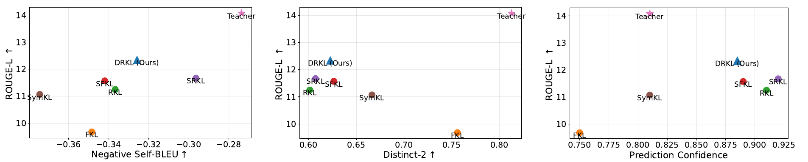

<div align="center">

# Diversity-Aware Reverse Kullback-Leibler Divergence<br>for Large Language Model Distillation

[Hoang-Chau Luong](https://scholar.google.com/citations?hl=en&user=j4ck-L4AAAAJ) · Dat Ba Tran · [Lingwei Chen](https://scholar.google.com/citations?user=CnKs0mEAAAAJ&hl=en)

[](https://arxiv.org/abs/2604.00223)


[](LICENSE)

</div>

> **TL;DR** Reverse KL (RKL) is the go-to objective for LLM distillation, but part of its gradient keeps pushing
> the target-token logit up, even after the student already matches the teacher. Students become **overconfident
> and less diverse**. **DRKL** removes that push with a one-line change to the loss and gives the best ROUGE-L on
> Qwen3, Llama-3.2 and OPT.

<p align="center">
  
  <br>
  <em>Fidelity vs. diversity and confidence (GPT-2 XL → GPT-2 Base, Self-Instruct). RKL is accurate but repetitive and
  overconfident; DRKL is more accurate, more diverse and less overconfident.</em>
</p>

## 💡 The idea

Let $m$ be the target token, $q$ the student and $p$ the teacher. RKL splits into a **target** term, over the
binary distribution $\tilde q_m = (q_m, 1 - q_m)$, and a **non-target** term, over the distribution $\hat q$ renormalized
on the other tokens (Proposition 1):

$$
D_{\mathrm{KL}}(q \,\|\, p) = D_{\mathrm{KL}}(\tilde q_m \,\|\, \tilde p_m) + (1 - q_m)\, D_{\mathrm{KL}}(\hat q \,\|\, \hat p)
$$

The weight $(1 - q_m)$ is the problem:

- **Shortcut.** The non-target loss drops when $q_m$ grows, without matching the teacher's tail, so the tail is poorly learned.
- **Overconfidence.** Its gradient on the target logit is $-q_m (1 - q_m)\, D_{\mathrm{KL}}(\hat q \,\|\, \hat p) \le 0$ (Proposition 2), so it keeps raising $q_m$ even when $q_m = p_m$.

**DRKL** replaces the weight with a constant $\gamma$, which removes that gradient and strengthens the tail supervision:

$$
\mathcal{L}_{\mathrm{DRKL}} = D_{\mathrm{KL}}(\tilde q_m \,\|\, \tilde p_m) + \gamma\, D_{\mathrm{KL}}(\hat q \,\|\, \hat p)
$$

It is a drop-in replacement for the RKL loss ([`distillm/losses.py`](distillm/losses.py)):

```python
import torch

def drkl(logits, teacher_logits, target, gamma=1.0):
    """DRKL on student / teacher logits [N, V] and target (label) tokens [N]."""
    m = target.unsqueeze(1)
    # target term: RKL between the binary distributions (q_m, 1 - q_m) and (p_m, 1 - p_m)
    q_m, p_m = logits.softmax(-1).gather(1, m), teacher_logits.softmax(-1).gather(1, m)
    q, p = torch.cat([q_m, 1 - q_m], 1), torch.cat([p_m, 1 - p_m], 1)
    target_rkl = (q * (q.clamp(min=1e-12).log() - p.clamp(min=1e-12).log())).sum(1)
    # non-target term: RKL between the distributions renormalized over the other tokens
    log_q_hat = logits.scatter(1, m, -1000.0).log_softmax(-1)
    log_p_hat = teacher_logits.scatter(1, m, -1000.0).log_softmax(-1)
    non_target_rkl = (log_q_hat.exp() * (log_q_hat - log_p_hat)).sum(1)
    # RKL weights the second term by (1 - q_m), DRKL by a constant gamma
    return (target_rkl + gamma * non_target_rkl).mean()
```

## ✨ Results

Average ROUGE-L over Dolly, Self-Instruct, Vicuna, Super-NI and UnNI (Table 1, five seeds):

| Objective | Qwen3 32B → 4B | Llama-3.2 3B → 1B | OPT 6.7B → 1.3B |
|:--|:-:|:-:|:-:|
| FKL | 25.65 | 22.90 | 20.91 |
| RKL | 27.30 | 26.71 | 21.07 |
| Sym-KL | 27.21 | 25.89 | 21.02 |
| DKD | 24.96 | 21.88 | 20.62 |
| JS | 25.78 | 24.46 | 21.36 |
| SFKL | 26.53 | 25.16 | 20.91 |
| SRKL | 26.89 | 26.47 | 20.61 |
| AKL | 25.93 | 25.12 | 20.92 |
| AB | 27.13 | 26.49 | 21.68 |
| **DRKL** | **27.72** | **27.14** | **23.11** |

DRKL is also best under on-policy distillation (Llama-3.2, 27.60 vs. 27.22 for AB) and with Claude Haiku 4.5 as the
judge (Qwen3, 41.50 vs. 34.47 for SRKL).

## 🚀 Quick start

```bash
git clone https://github.com/lhchau/drkl-diversity-aware-kl.git
cd drkl-diversity-aware-kl
pip install -r requirements.txt

# 1. download the benchmarks and the OPT checkpoints, tokenize Dolly
bash scripts/prepare_data.sh opt

# 2. distill OPT-6.7B into OPT-1.3B with DRKL
bash scripts/train.sh opt-1.3b drkl

# 3. ROUGE-L and diversity on 5 benchmarks x 5 seeds
bash scripts/eval.sh opt-1.3b results/opt-1.3b/drkl-gamma1.0-seed10/best_rougeL
```

## 🧪 Usage

```bash
bash scripts/train.sh <config> <loss> [seed] [extra finetune.py args]
bash scripts/eval.sh  <config> <checkpoint>
```

| `<config>` | Teacher → Student | Fine-tuning | γ |
|:--|:--|:-:|:-:|
| `qwen3-4b` | Qwen3-32B → Qwen3-4B | LoRA | 1.5 |
| `llama3-1b` | Llama-3.2-3B → Llama-3.2-1B | LoRA | 0.5 |
| `opt-1.3b` | OPT-6.7B → OPT-1.3B | full | 1.0 |
| `gpt2-base` | GPT-2 XL (1.5B) → GPT-2 Base (120M) | full | 0.5 |
| `gpt2-medium` | GPT-2 XL (1.5B) → GPT-2 Medium (340M) | full | 0.5 |

| `<loss>` | Objective |
|:--|:--|
| `drkl` | **DRKL** (ours) |
| `srkl_drkl` | DRKL with SRKL's skewed teacher, α = 0.1 |
| `fkl`, `rkl` | forward KL(p‖q), reverse KL(q‖p) |
| `symkl` | Sym-KL: 0.1 · FKL + 0.9 · RKL, as in DistiLLM |
| `dkd` | decoupled KD, α = 1, β = 2 ([Zhao et al., 2022](https://arxiv.org/abs/2203.08679)) |
| `js` | generalized Jensen–Shannon, λ = 0.9 ([Agarwal et al., 2024](https://arxiv.org/abs/2306.13649)) |
| `sfkl`, `srkl` | skewed FKL / RKL, α = 0.1 ([Ko et al., 2024](https://arxiv.org/abs/2402.03898)) |
| `akl` | adaptive KL ([Wu et al., 2025](https://arxiv.org/abs/2404.02657)) |
| `ab` | α-β divergence, α = 0.2, β = 0.7 ([Wang et al., 2025](https://arxiv.org/abs/2505.04560)) |
| `sft` | plain fine-tuning, no teacher |

- The OPT and GPT-2 teachers are downloaded already fine-tuned. Fine-tune the Qwen3 and Llama teachers first with
  `bash scripts/train.sh qwen3-32b sft` or `bash scripts/train.sh llama3-3b sft`.
- `GAMMA=2.0 bash scripts/train.sh ...` changes γ. `--drkl-gamma-start 0.1` grows γ linearly to its final value (DRKL-linear).
- `--on-policy` trains on student-generated samples, using DistiLLM's adaptive schedule.
- `--log-rkl-terms` adds $q_m$, both KL terms of RKL and the gradient $\partial \mathcal{L}_{\mathrm{NRKL}} / \partial z_m$ to the training log.

<details>
<summary><b>Training and evaluation details</b></summary>

- Global batch size of 32 on any number of GPUs; gradient accumulation is set automatically.
- OPT and GPT-2: full fine-tuning for 20 epochs, max length 512, learning rate 5e-5 (OPT) or 5e-4 (GPT-2). The OPT
  student starts from MiniLLM's OPT-1.3B initialized on Dolly.
- Qwen3 and Llama: LoRA (r = 16, α = 32, dropout 0.05) for 10 epochs, max length 1024, learning rate 1.5e-4 (Qwen3)
  or 1e-4 (Llama). The Qwen3 runs average the distillation and SFT losses (`--kd-ratio 0.5`). The Qwen3-32B teacher
  alone takes 64 GB in bf16, so each GPU must fit it next to the student.
- After every epoch the student is scored on held-out Dolly examples (1,000; 200 for LoRA) and the checkpoint with
  the best ROUGE-L is kept.
- Evaluation samples at temperature 1 with seeds 10–50 and reports the mean ± std of ROUGE-L, Distinct-2 and negative
  Self-BLEU (over groups of `EVAL_BATCH_SIZE` responses), and of the student's entropy and confidence (max probability)
  along the reference answers. Use `BENCHMARKS="dolly vicuna"` or `SEEDS=10` to run a subset.

</details>

## 📊 Reproducing the paper

| In the paper | How to run |
|:--|:--|
| Table 1 | `train.sh <config> <loss>` for every loss on `qwen3-4b`, `llama3-1b`, `opt-1.3b`, then `eval.sh` |
| Table 2 | `train.sh llama3-1b <loss> 10 --on-policy` |
| Table 3 | `python tools/llm_judge.py data/<benchmark> <checkpoint>/eval/<benchmark>/seed10` for `self-inst`, `vicuna`, `uinst/11_` |
| Table 5 | the Table 1 loop on `gpt2-base`, `gpt2-medium`; DRKL-linear: `GAMMA=1.0 bash scripts/train.sh gpt2-base drkl 10 --drkl-gamma-start 0.1` |
| Figures 2, 6 | diversity, entropy and confidence columns printed by `eval.sh` |
| Figures 3, 9 | `train.sh opt-1.3b rkl 10 --log-rkl-terms` (and `drkl`); `train.sh qwen3-4b rkl 10 --log-rkl-terms`; read `log.txt` |
| Figure 4a | `train.sh opt-1.3b srkl_drkl` |
| Figure 4b | `GAMMA=<γ> bash scripts/train.sh gpt2-base drkl` for γ ∈ {0.5, 1.0, …, 4.0} |
| Figure 4c, 8 | the `s/step` and `valid` lines of `log.txt` |

<details>
<summary><b>Repository structure</b></summary>

```
├── finetune.py           SFT and distillation; keeps the best checkpoint by validation ROUGE-L
├── evaluate.py           sampling, fidelity and diversity metrics on one benchmark
├── metrics.py            ROUGE-L, Distinct-2, Self-BLEU
├── distillm/
│   ├── losses.py         DRKL and all baseline objectives
│   ├── sampler.py        student sampling for on-policy training
│   └── buffer.py         replay buffer of student samples
├── data_utils/           tokenized training data and evaluation prompts
├── scripts/
│   ├── prepare_data.sh   download and tokenize
│   ├── train.sh          train one model
│   ├── eval.sh           evaluate one checkpoint
│   └── configs/          one file per model
├── tools/                Dolly tokenization, result summary, LLM-as-a-judge
├── configs/deepspeed/    ZeRO-1 fp16 (GPT-2, OPT), ZeRO-2 bf16 (Llama, Qwen)
└── tests/                CPU tests: python -m pytest tests
```

</details>

## 🙏 Acknowledgements

Built on [MiniLLM](https://github.com/microsoft/LMOps/tree/main/minillm) and [DistiLLM](https://github.com/jongwooko/distillm).

## 📝 Citation

```bibtex
@article{luong2026drkl,
  title   = {Diversity-Aware Reverse Kullback-Leibler Divergence for Large Language Model Distillation},
  author  = {Luong, Hoang-Chau and Tran, Dat Ba and Chen, Lingwei},
  journal = {arXiv preprint arXiv:2604.00223},
  year    = {2026}
}
```

For questions, open an issue or email Hoang-Chau Luong (cl6300@rit.edu).
